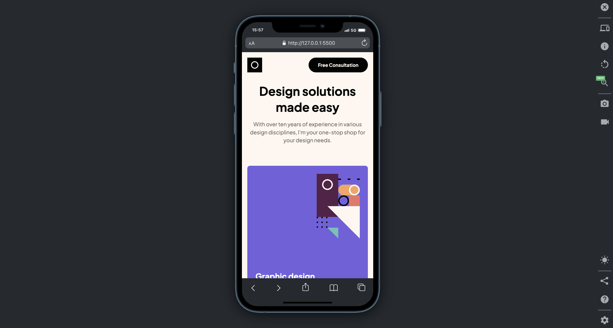
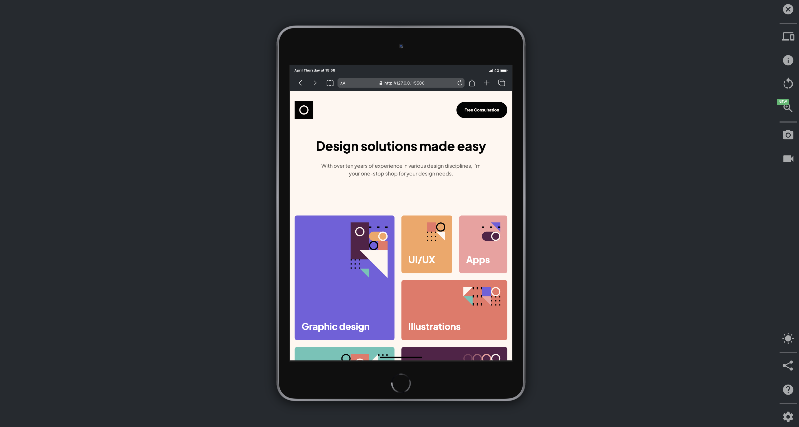
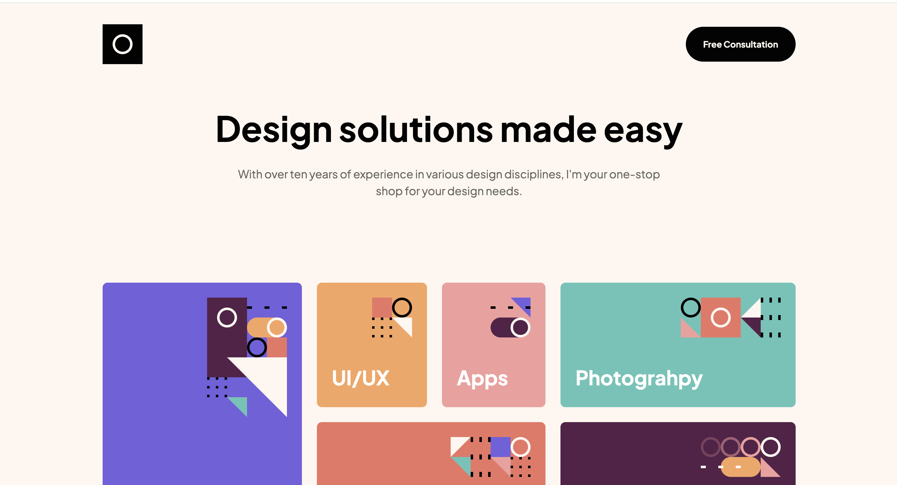

# Single-Page Portfolio

Translating a Single-Page Desgin Portfolio UI in figma into code.

## 📌 Table of Contents

- [🚀 Getting Started](#-getting-started)
- [🛠️ Tech Stack](#-tech-stack)
- [📦 Installing](#-installing)
- [💻 Running the Application](#-running-the-application)
- [📋 Approach](#-approach)
- [📸 Screenshots](#-screenshots)
- [🚀 Deployment](#-deployment)
- [👤 Author](#-author)

## 🚀 Getting Started

This project is built using HTML and CSS and hosted on Netlify.

## 🛠️ Tech Stack

- HTML
- CSS

## 📦 Installing

Clone the repository and install dependencies:

```sh
git clone https://github.com/victorbruce/single-page-portfolio
cd single-page-portfolio
```

## 💻 Running the Application

To start the development server:

- Install the **Live Server extension**(by Ritwick Dey) in VsCode
- Right-click anywhere in the html code
- Select _Open with Live Server_ from the menu to start the development server

Or

Double click the `index.html` file to open the code in the browser of your choice.

## 📋 Approach

- Structured my project folder and connect stylesheets to HTML.
- Reset global styles and define base styles for fonts and colors
- Next, I worked on the navigation components(main and footer navigations) and enusred they are responsive and accessible across all major devices
- After, I started working on the main sections of the website (hero, services, about, work, and bookings)

**Git Commands Used**

- **git status**: to check or show the current state of my working
- **git log**: shows the list of all commits
- **git checkout**: use to switch to another branch
- **git checkout -b `<branch_name>`**: uset to create a new branch and switch into.
- **git add**: use to stage changes made and prepare for the next commit
- **git commit**: saves a saved staged changes as a snapshot in a projects history with a snap.
- **git pull**: it gets the latest changes from a branch on orgin and merge them into a local branch
- **git push**: use to send committed changes to a remote repository.

## 📸 Screenshots





## 🚀 Deployment

Find the deployment documentation [here](./deployment.md)

## 👤 Author

Victor Bruce
